# Bài 3 — Giao tiếp thời gian thực với SignalR

> **MSSV:** `<MSSV>` — **Họ và tên:** `<Họ và tên>`
>
> Thay hai chỗ trên bằng thông tin của bạn trước khi nộp.

Thư mục này gồm **hai solution** đúng yêu cầu bài nộp:

| Solution | Nội dung | Cổng |
|---|---|---|
| [`PingSignalR/`](PingSignalR/README.md) | Hub 4 phương thức, client console, tự nối lại, 3 lỗi cố ý | 5200 |
| [`RealtimeSubmissionSystem/`](RealtimeSubmissionSystem/README.md) | EduSubmit REST + `SubmissionHub` + chấm nền + client hai kênh | 5000 |

## 1. Ba câu hỏi đầu giờ

### 1. Vì sao máy chủ chủ động báo tốt hơn máy khách hỏi liên tục?

Máy chủ là nơi biết sự kiện xảy ra **đầu tiên**. Giả sử 100 sinh viên cùng chờ trong
1 phút, mỗi bài đổi trạng thái 2 lần:

- **Polling mỗi 2 giây:** `100 × 30 = 3.000` yêu cầu, chỉ khoảng `200` yêu cầu (≈7%)
  mang tin mới, và mỗi thay đổi có thể trễ tới 2 giây.
- **Push qua kết nối mở:** `100 × 2 = 200` thông báo, cả 200 đều có ích, đến ngay.

Push tiết kiệm đường truyền, giảm tải máy chủ, giảm độ trễ. Đổi lại phải giữ kết nối,
xử lý mất kết nối/nối lại và không được coi thông báo là dữ liệu bền vững.

### 2. REST và SignalR chia việc thế nào?

- **REST** tạo và đọc tài nguyên: `POST` nộp bài, `GET` danh sách/chi tiết. Đây là
  **nguồn sự thật**; dữ liệu vẫn đúng khi không có ai đang kết nối.
- **SignalR** chỉ báo *đã có thay đổi*: `processing`, `graded`. Không lưu tin, không
  thay thế REST.
- Khi mất kết nối, nối lại hoặc Watch muộn: gọi `GET /api/submissions/{id}` để đồng bộ.
- Máy chủ cập nhật kho **trước**, rồi mới đẩy thông báo; nhờ vậy client nhận tin là
  đọc REST thấy ngay trạng thái mới.

### 3. Vì sao đặt thông báo đúng lúc trạng thái đổi (báo `graded`)?

Thông báo chỉ có nghĩa khi gắn với **sự kiện thật**: `received → processing → graded`.
Đặt ở lúc `graded` giúp:

- Không báo khi mới nộp (chưa có kết quả), không báo lặp mỗi lần bị hỏi.
- Chỉ gửi cho nhóm `submission:{id}` quan tâm, không phát cho toàn bộ kết nối.
- Gói tin mang đủ `Id`, `Status`, `UpdatedAt` để client biết bài nào, trạng thái nào,
  lúc nào — tránh mơ hồ.
- Nếu lỡ thông báo (mất mạng, Watch muộn), client vẫn đọc lại REST để lấy trạng thái
  cuối; thông báo chỉ là tín hiệu, không phải nguồn sự thật.

## 2. Chạy nhanh

Yêu cầu: .NET SDK **10.0** (đã kiểm tra với `10.0.404`, runtime `10.0.15`), VS Code +
**C# Dev Kit** + **REST Client**. Không cần SQL Server/Redis.

```powershell
# ---- PingSignalR ----
dotnet run --project PingSignalR/src/Ping.Api
# Terminal khác:
dotnet run --project PingSignalR/src/Ping.Client -- http://localhost:5200 An
# Terminal thứ ba:
dotnet run --project PingSignalR/src/Ping.Client -- http://localhost:5200 Binh

# ---- EduSubmit ----
dotnet run --project RealtimeSubmissionSystem/src/Submission.RealtimeApi
# Terminal khác:
dotnet run --project RealtimeSubmissionSystem/src/Submission.RealtimeClient -- http://localhost:5000 SV001
```

Client Ping chạy mặc định **tự động** gửi `Echo → JoinGroup → Broadcast → SendToGroup`
rồi chờ Enter, đúng kịch bản slide. Thêm `--interactive` nếu muốn tự gõ lệnh.

Trong VS Code: **Terminal → Run Task…** có `Build: cả hai solution`, `Ping: máy chủ
(5200)`, `Ping: An`, `Ping: Bình`, `Edu: máy chủ (5000)`, `Edu: máy khách`,
`Edu: khách Watch muộn`, `Edu: khách sai sự kiện`, `Edu: khách sai hub`,
`Edu: khách repo http (failed)`. Hoặc bấm **F5** với các cấu hình trong
`.vscode/launch.json`.

## 3. Kết quả chạy EduSubmit

### 3.1. Bảy yêu cầu kiểm tra

| # | Yêu cầu | Kết quả thật |
|---|---|---|
| 1 | `GET /api/assignments` | `200`, 2 assignment |
| 2 | `POST /api/assignments/1/submissions` đủ trường | `201`, `Location: /api/submissions/1` |
| 3 | `POST` với `{}` | `400`, lỗi `studentCode`, `repositoryUrl` |
| 4 | `POST /api/assignments/999/submissions` | `404`, `Assignment 999 không tồn tại` |
| 5 | `POST /hubs/submissions/negotiate?negotiateVersion=1` | `200`, `connectionId` + 3 transport |
| 6 | `GET` theo `Location` sau 5 giây | `200`, `"status":"graded"` |
| 7 | `POST :5200/hubs/ping/negotiate?negotiateVersion=1` | `200` |
| + | `POST` với `repositoryUrl` dùng `http://` | `201`, `"status":"failed"`, không chấm bài |

### 3.2. Máy khách nhận thông báo thật

```text
Đã kết nối SignalR. ConnectionId: 88lQ99iLL1gXyWxoQ9hdIg
POST /api/assignments/1/submissions -> 201
Location: /api/submissions/3
Đã đăng ký theo dõi: submission:3
Đã gọi WatchSubmission(3)
Thông báo SignalR: submission 3 -> processing lúc 09:12:09
Thông báo SignalR: submission 3 -> graded lúc 09:12:11
Đã nhận đủ thông báo cho submission 3 (trạng thái cuối: graded).
REST GET /api/submissions/3 -> 200
Trạng thái cuối từ REST: graded (UpdatedAt: 09:12:11)
Hoàn tất: REST là nguồn sự thật, SignalR chỉ báo thay đổi.
```

Hai dòng `Thông báo SignalR` cách nhau khoảng **2 giây**; trong khoảng đó máy khách
không hề gọi REST.

### 3.3. Yêu cầu cộng điểm: `repositoryUrl` không bắt đầu bằng `https://`

```text
POST /api/assignments/1/submissions -> 201
Location: /api/submissions/4
Submission bị đánh dấu failed: repositoryUrl phải bắt đầu bằng https://.
Máy chủ không chấm bài nên không có thông báo SignalR.
REST GET /api/submissions/4 -> 200
Trạng thái cuối từ REST: failed (UpdatedAt: 09:12:11)
```

Máy chủ vẫn tạo bản ghi để tra cứu nhưng đặt `status = failed` ngay từ POST và
**không** đưa vào bộ chấm nền.

## 4. Năm thí nghiệm

| # | Thí nghiệm | Dự đoán | Kết quả thật | Bài học |
|---|---|---|---|---|
| 1 | Hai máy khách cùng lúc | Mỗi người chỉ thấy bài của mình | A nhận submission 7, B nhận submission 8; không lẫn | Nhóm `submission:{id}` tách đúng người nhận |
| 2 | Máy chủ chưa chạy | Lỗi kết nối ngay | `HttpRequestException: ... actively refused` | Lần nối đầu không tự thử lại; phải bật server trước |
| 3 | Sai `/hub/submissions` | 404 ở negotiate | `404 (Not Found)` | `WithUrl` phải khớp `MapHub`, có `/hubs/` |
| 4 | Sai tên sự kiện `On` | Không lỗi, không nhận tin | Quá thời gian chờ; REST vẫn `graded` | Sai tên chiều xuống = im lặng |
| 5 | Watch muộn 4 giây | Lỡ thông báo | Không nhận tin nào; REST đọc lại `graded` | Vào nhóm muộn là lỡ tin; REST là nguồn sự thật |

Thứ tự đúng là **POST → Watch → chờ push → GET chốt**: Watch trước khi có id thì không
biết nhóm nào; Watch sau khi trạng thái đổi thì đã lỡ thông báo.

## 5. Minh chứng trong `anh/`

### PingSignalR

**Bước 1 — build sạch cả hai solution**

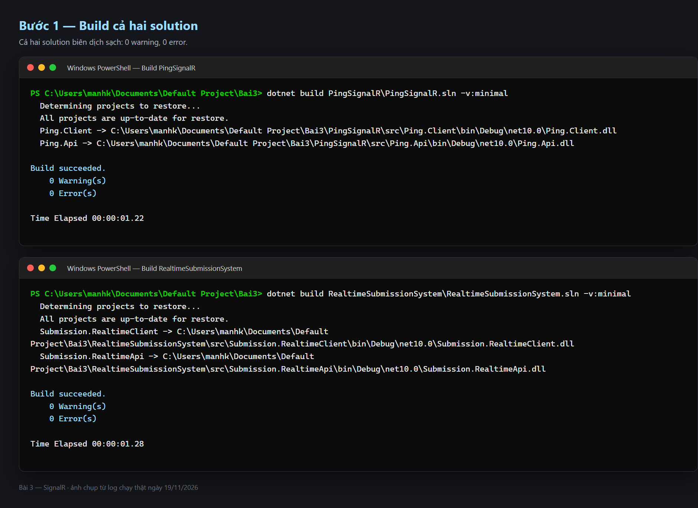

**Bước 2 — negotiate trả 200**

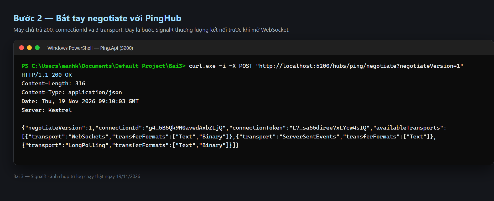

**Bước 3–4 — Echo chỉ về người gọi**

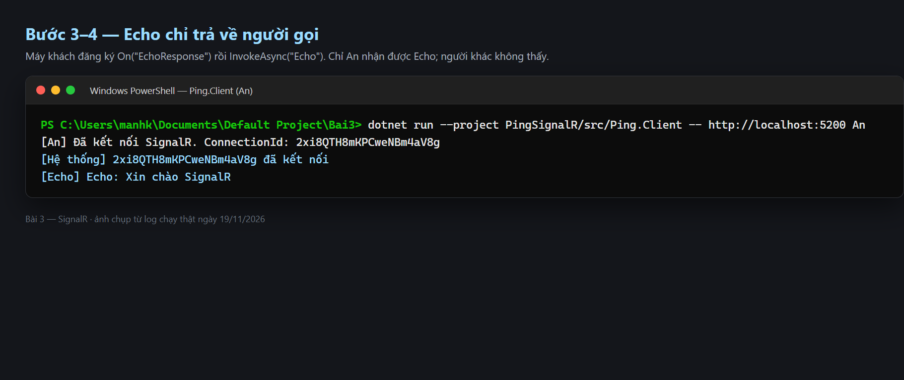

**Bước 5 — Broadcast và tin theo nhóm**

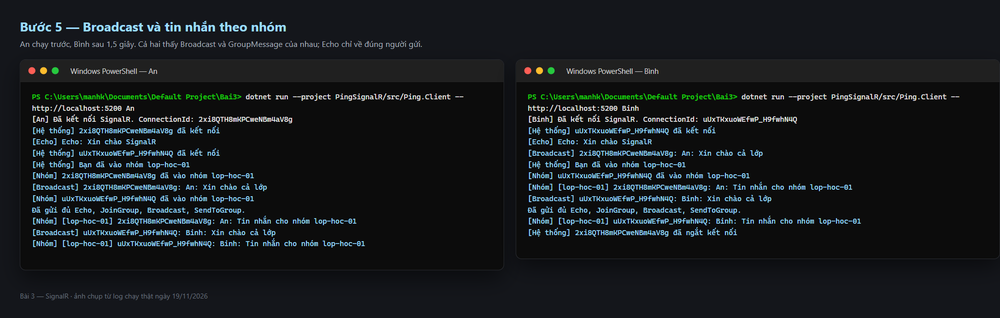

**Bước 6 — mất kết nối và tự nối lại**

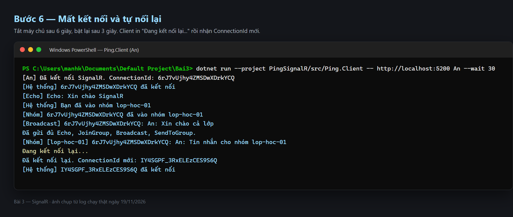

**Bước 7 — ba bài lab lỗi**

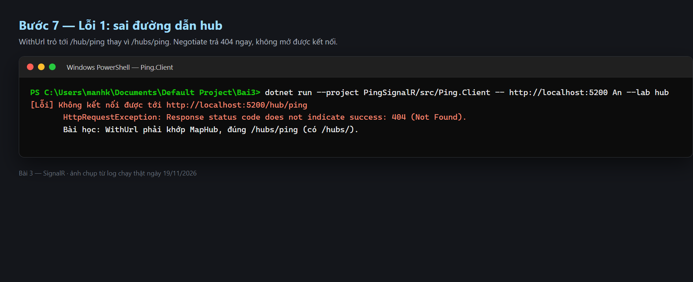
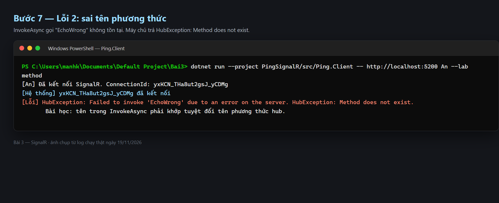
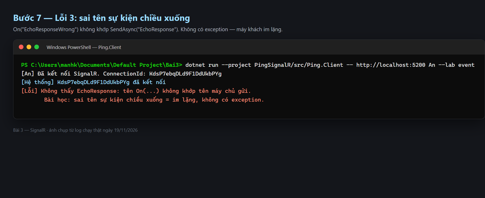

### EduSubmit

**REST và negotiate**

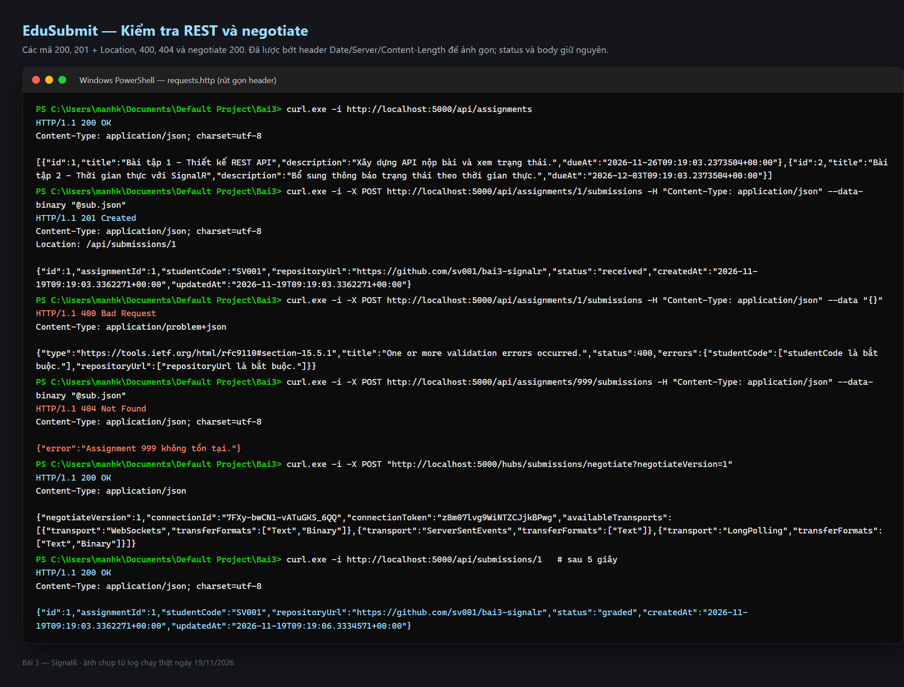

**Máy khách nhận processing → graded**

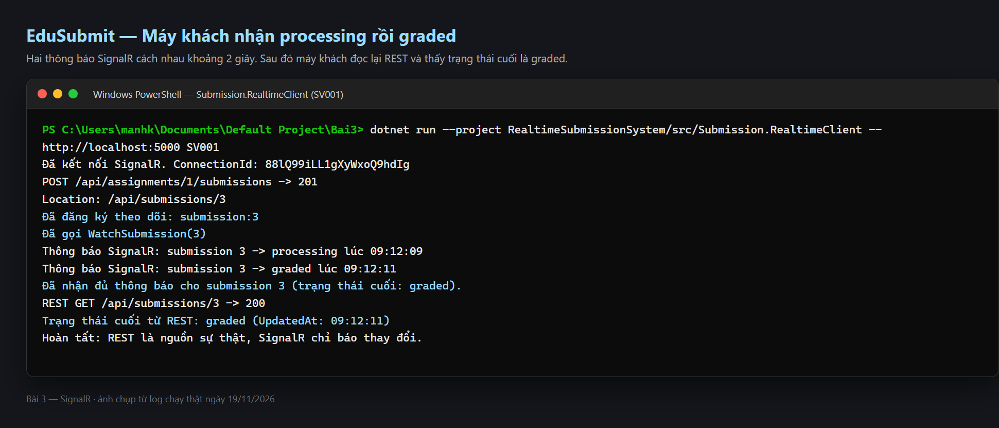

**Trạng thái failed khi repo dùng http://**

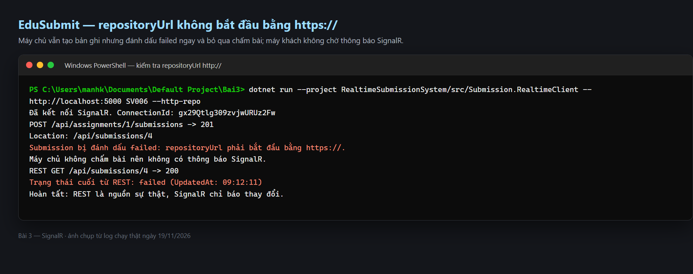

**Năm thí nghiệm**

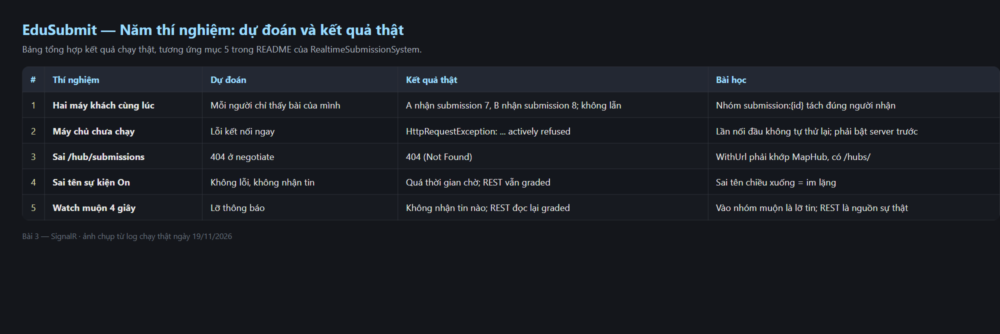

**Log Hub và Push của máy chủ**

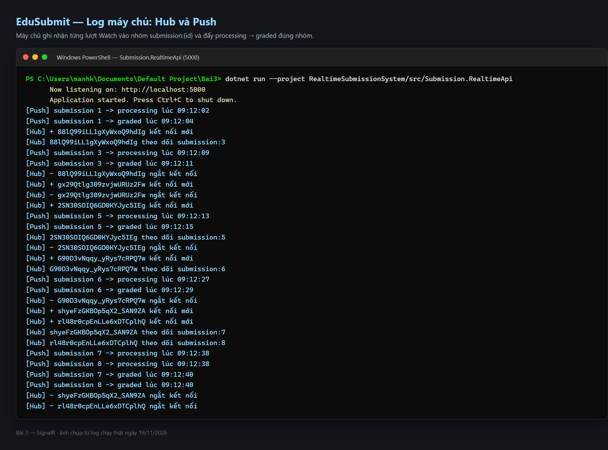

## 6. Đối chiếu thang điểm (10 điểm + 0,5 cộng)

| Tiêu chí | Điểm | Minh chứng |
|---|---:|---|
| 1. Chạy được | 4 | Build 0 lỗi; 7 yêu cầu kiểm tra đạt; client Ping nhận Echo; client Edu nhận `graded` |
| 2. `requests.http` | 2 | 12 request: 200, 201, 400, 404, negotiate cả hai hub, thêm case `failed` |
| 3. Giải thích | 2 | Mục 1 trả lời đủ 3 câu: push vs polling, REST/SignalR chia việc, báo đúng lúc `graded` |
| 4. Thí nghiệm | 1 | Mục 4: bảng 5 thí nghiệm dự đoán → kết quả thật → bài học |
| 5. Git & PR | 1 | Commit theo bước, `.gitignore` loại `bin/`, `obj/`; PR theo mẫu |
| **Cộng** | **+0,5** | `repositoryUrl` không bắt đầu bằng `https://` → `status: failed` (mục 3.3) |

## 7. Cấu trúc

```text
Bai3/
├─ .vscode/                     # task + launch + extension gợi ý
├─ anh/                         # 13 ảnh minh chứng
├─ docs/verification.md         # biên bản kiểm thử chi tiết
├─ PingSignalR/
│  ├─ PingSignalR.sln
│  └─ src/Ping.Api, src/Ping.Client
├─ RealtimeSubmissionSystem/
│  ├─ RealtimeSubmissionSystem.sln
│  ├─ requests.http             # 12 request
│  └─ src/Submission.RealtimeApi, src/Submission.RealtimeClient
└─ README.md                    # tệp này
```

## 8. Nộp bài

```powershell
cd Bai3
git status                     # không thấy bin/, obj/
git log --oneline              # commit theo bước
```

Tạo PR vào repo lớp với tiêu đề `Bai3 - <MSSV> - <Họ và tên>`. Chỉ sửa trong thư mục
bài của mình, không commit `bin/`, `obj/`, `.vs/`.
